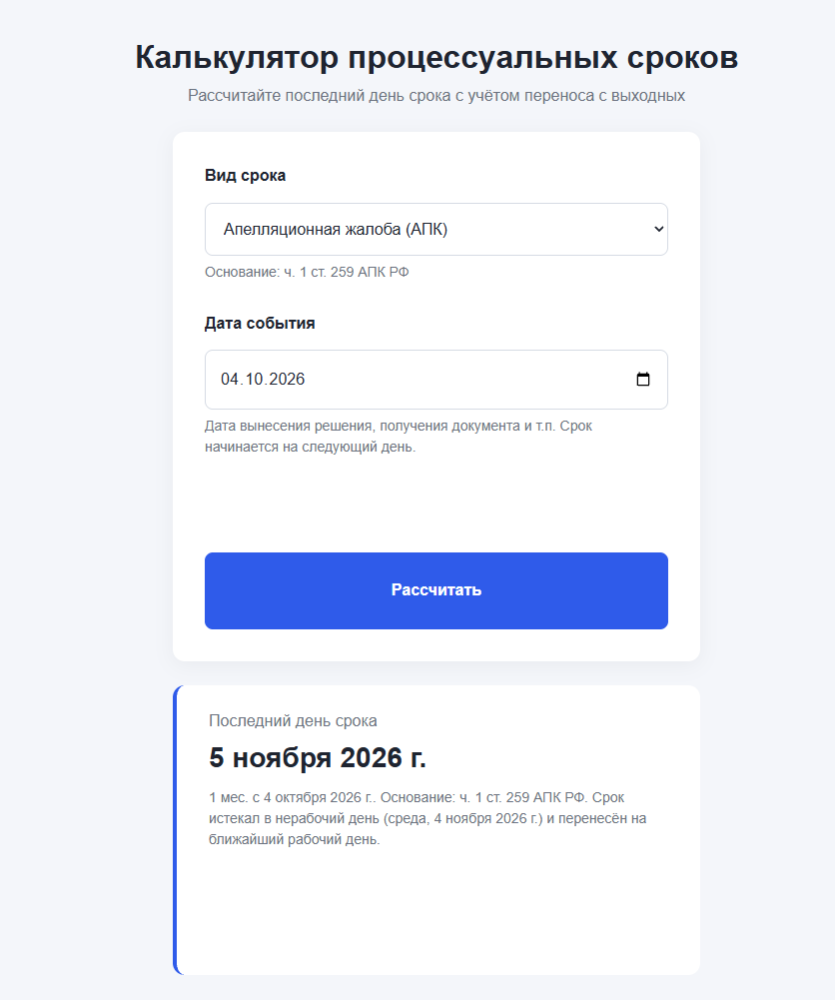

# Калькулятор процессуальных сроков

Веб-приложение для расчёта последнего дня процессуального срока по АПК РФ, ГПК РФ и Закону о банкротстве — с учётом выходных, праздников и переносов по производственному календарю.

**[Открыть приложение →](https://julijasidorak22-prog.github.io/deadline-calculator/)**



## Зачем

Юристы ежедневно считают сроки на обжалование, подачу возражений и ответы на претензии. Ошибка в один день может стоить пропуска срока. Приложение считает срок по правилам ГК РФ и процессуальных кодексов и показывает, был ли перенос с нерабочего дня.

Автор — практикующий юрист, поэтому правила расчёта заложены по нормам закона, а не «на глаз».

## Возможности

- 8 видов сроков: апелляция и кассация по АПК и ГПК, частная жалоба, возражения на судебный приказ, апелляция на определение в деле о банкротстве, ответ на претензию
- три способа исчисления: календарные дни, месяцы, рабочие дни
- перенос окончания срока с выходного или праздника на ближайший рабочий день
- производственный календарь РФ на 2026–2027 гг., включая рабочие субботы
- правовое основание для каждого вида срока
- пояснение, если срок был перенесён, и предупреждение, если календарь на нужный год не заполнен
- валидация формы и вывод ошибок без перезагрузки страницы
- адаптивная вёрстка для мобильных устройств

## Правила расчёта

| Правило                                                                                                     | Норма                                              | Как реализовано                               |
| ----------------------------------------------------------------------------------------------------------- | -------------------------------------------------- | --------------------------------------------- |
| Срок начинается на следующий день после события                                                             | ст. 191 ГК РФ, ст. 113 АПК РФ, ст. 107 ГПК РФ      | дата события + N дней                         |
| Срок в месяцах истекает в соответствующее число последнего месяца, а если его нет — в последний день месяца | п. 3 ст. 192 ГК РФ                                 | `addMonths`: 31.01 + 1 мес. = 28.02           |
| В сроки, исчисляемые днями, не включаются нерабочие дни                                                     | ч. 3 ст. 114 АПК РФ, ч. 3 ст. 107 ГПК РФ           | `addWorkdays` пропускает выходные и праздники |
| Если последний день нерабочий, срок переносится на ближайший рабочий день                                   | ст. 193 ГК РФ, ч. 4 ст. 114 АПК РФ, ст. 108 ГПК РФ | `moveToWorkday`                               |

## Технологии

- HTML5 — семантическая разметка, форма с `novalidate`
- CSS3 — Grid, Flexbox, CSS-переменные, медиазапросы, БЭМ
- JavaScript (ES6+) — работа с DOM, обработка событий, объект `Date`, методы массивов (`forEach`, `find`, `includes`)

Без фреймворков и библиотек.

## Интересные задачи

**Месяцы разной длины.** Стандартный `setMonth()` для 31 января + 1 месяц возвращает 3 марта. Решение: определять последний день целевого месяца через `new Date(year, month + 1, 0)` и брать меньшее из двух чисел.

**Часовые пояса.** `new Date('2026-10-18')` читается как полночь по UTC, из-за чего в некоторых часовых поясах дата сдвигается на день. Поэтому дата из поля ввода собирается по частям в локальном времени.

**Сравнение дат.** Два объекта `Date` с одинаковым значением не равны при сравнении через `===`, поэтому даты сравниваются через `getTime()`.

## Структура проекта

```
deadline-calculator/
├── index.html
├── styles/
│   └── style.css
└── scripts/
    ├── data.js       — виды сроков и правовые основания
    ├── holidays.js   — производственный календарь
    ├── dates.js      — функции расчёта дат
    └── main.js       — работа с формой и DOM
```

## Как запустить локально

```bash
git clone https://github.com/julijasidorak22-prog/deadline-calculator.git
```

Открыть `index.html` в браузере. Сборка и установка зависимостей не нужны.

## Планы

- [ ] история расчётов в `localStorage`
- [ ] загрузка производственного календаря через API
- [ ] новые виды сроков (ГПК, КАС, налоговые)
- [ ] экспорт срока в календарь (`.ics`)

## Важно

Расчёт носит справочный характер и не заменяет проверку сроков юристом.
